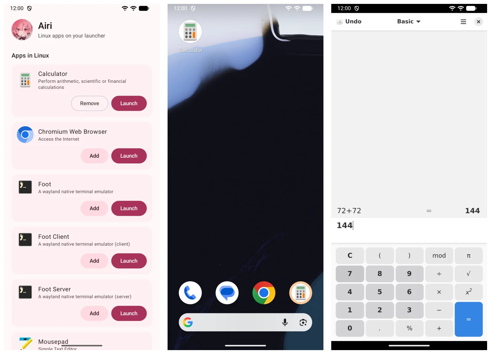

<p align="center">
  
</p>

<h1 align="center">Airi</h1>

<p align="center">Linux apps on your Android launcher.</p>

<p align="center">
  <a href="https://github.com/wonderhoy-labs/airi/actions/workflows/build.yml"></a>
  <a href="LICENSE"></a>
</p>

<p align="center"><sub>A <a href="https://github.com/wonderhoy-labs">Wonderhoy Labs</a> project</sub></p>

Android's Terminal app runs a real Debian in a virtual machine, and it can show graphical apps. The catch is that they
all live inside one Display window, as far as Android is concerned, in a little desktop of their own.

Airi takes them out of there. Each Linux app gets:

- its own icon on your launcher, next to your other apps
- its own window, with its own name and icon in Recents
- the size of whatever window Android gives it, including when you rotate or the keyboard opens
- touch and the on-screen keyboard

It doesn't need root, Shizuku or a computer. Setup takes one paste into the terminal.



> **This is early.** We've only tested it on one Pixel 10 Pro running Android 17. Nothing in the code is tied to that
> model, so other phones with the Terminal app should work. If you try one, please
> [open an issue](https://github.com/wonderhoy-labs/airi/issues) and tell us how it went, even if it just worked.

## What you need

A phone with Android's Terminal app, which needs a 64-bit Arm phone that can run virtual machines. On a Pixel, turn on
**Linux development environment** in Developer options, then open the Terminal app and let it download Debian.

Linux needs its own apps, so install some in the terminal. For example:

```bash
sudo apt install gnome-calculator
```

## Install

Download the APK from [Releases](https://github.com/wonderhoy-labs/airi/releases) and open it on your phone, or install it
with `adb`:

```bash
adb install -r airi-v0.1.0.apk
```

You can also [build it yourself](#development).

## Set up

Android doesn't let apps run anything in Linux, so this is the one step you do by hand.

1. Open Airi and tap **Copy command and open Terminal**.
2. In the terminal, touch and hold, tap **Paste**, then press Enter.
3. When a notification asks about port 47821, tap **Allow always**. If you miss it, it's in the Terminal app's settings
   under **Security**.

Go back to Airi and your Linux apps are there. You only do this once, and the helper it installs starts by itself whenever
Linux does.

## Use it

**Launch** opens an app straight away.

**Add** puts it on your launcher as an app of its own. The first time, Android asks you to allow Airi to install apps, and
then it asks you to confirm each one. **Remove** takes it off again. Apps added this way find their way into your launcher's
search and app list like any other. Tapping one starts Linux if it isn't running.

| To do this | Do this |
| --- | --- |
| Leave an app running | Go home or swipe back, like any other app |
| Close an app | Swipe it away in Recents, or use its own close button |
| Show the keyboard | It opens when a text field asks for it, or tap the round button on the right edge |
| Paste into Linux | Copy on Android, then go to the Linux app |

Some apps won't go as small as a phone, like Chromium, which needs 500 logical pixels of width. Airi zooms those out just enough to
fit, so they still fill the window. If you install something new in Linux, it shows up the next time you open Airi.

### From the terminal

To open something in Android from the terminal, run it with `airi-agent`. Android gets a window for it if a Linux app is already
open in Airi.

```bash
~/.local/bin/airi-agent run gnome-calculator
```

## What works

| | Status |
| --- | --- |
| Wayland apps | Yes. Tried with GNOME Calculator, Mousepad, Foot and Chromium |
| X11 apps | Yes, through Xwayland, and they look soft. Tried with XTerm |
| Touch | Yes |
| On-screen keyboard | Yes. Non-US characters need an app that takes text input directly |
| Rotation | Yes |
| Dialogs and menus | Dialogs share their app's window. Only lightly tried |
| A physical keyboard | Written, but not tried on a real one |
| A mouse | Written, but not tried on a real one |
| Clipboard | Written, but not tried yet |
| Sound | Goes through the Terminal app and not Airi. We haven't checked it |
| Pixel desktop mode and resizable windows | Should work, and we haven't tried it |
| Video and games | Every frame is copied by the processor, so expect them to be slow. We haven't measured it |

## How it works

```
                    Android                                     Linux, in Android's VM
┌──────────────────────────────────────────┐      ┌───────────────────────────────────────────┐
│  Launcher icon (a tiny generated app)    │      │  airi-agent: a Wayland compositor         │
│        │                                 │      │  with no screen of its own                │
│        ▼                                 │      │        ▲                                  │
│  Airi's viewer  ──── one per window ─────┼──────┼──►  a private "screen" per Android window │
│  decompresses frames into a surface      │ TCP  │        ▲                                  │
│  sends touch, keys, text and size        │47821 │  Linux apps, directly or through Xwayland │
└──────────────────────────────────────────┘      └───────────────────────────────────────────┘
```

### The agent

Android's Terminal app has no way to give a Linux window its own Android window, so Airi brings its own compositor instead of
using the Terminal's. The agent is built with [Smithay](https://github.com/Smithay/smithay) and runs as a user service in Linux.

It gives every Android window a private screen of exactly that window's size, and the Linux app there fills it. Apps are told
they're maximized and tiled, so they drop their shadows and rounded corners. An app with a minimum size that doesn't fit gets told
the screen has a lower density, which gives it the room it needs while it still draws pixel for pixel. Dialogs stay on their parent's screen. A window
nobody asked for, like a second window from the same app, makes Android open a new one for it.

Drawing happens in software with Pixman. Only the parts of a window that changed go out, as LZ4-compressed rectangles of raw
pixels. There's no video encoder, so text stays sharp. Android acknowledges each frame, and with at most two in flight, a slow
moment costs frame rate instead of building up a delay.

The agent reads `.desktop` files to list apps, including Flatpak's, and renders their icons from SVG or PNG. It works out which app
a new window belongs to from its app ID, its X11 class or its process.

### The connection

The Terminal app already forwards ports from Linux to Android's loopback, so that's what Airi uses. The agent only listens on Linux's
own loopback, and the Terminal's forwarder reaches it there. We measured that route at about 280 MB/s.

[docs/protocol.md](docs/protocol.md) has the details.

### The launcher apps

Pinned shortcuts only reach the home screen, so **Add** makes a real app. Airi carries a template of about 11 KB, built with it, and
changes four things in a copy: the package, the name, the icon, and which Linux app it opens. Changing a compiled manifest means
rebuilding its string table, which is all `BinaryManifest.kt` does. Then Android's own signing library signs it, with a key that's
made on your phone and stays in Android's Keystore.

The app has no secrets and no native code. It starts Airi's viewer and stays underneath it, because Android names a task in Recents
after the activity at its root, and that's what makes it say Calculator and not Airi.

### Keeping the picture steady

The keyboard is what makes this hard, because a window changes size every time it opens. Three things keep that from showing:

- The surface never changes size for the keyboard. It slides over, and the frames are drawn at one-to-one, so nothing gets stretched.
- After a resize, the agent keeps showing the old picture until the app has finished drawing the new one, for up to 600 ms.
- Android reports where the keyboard will end up as it starts to move, so the app redraws during the slide.

Key repeat comes from Android and not from the Linux apps, because an app busy redrawing misses a key going up and types the letter
over and over.

## Security

Worth reading, because the agent is a way into Linux.

**The token is what protects all of this.** It's 32 random bytes that Airi makes, and that travel to Linux in the setup command. With
it, you can open apps, send them input and see them, and replace the agent, which means running anything as the `droid` user. That
user has `sudo` without a password in the Terminal's Debian. Airi keeps the token in its private storage, and Linux keeps it in
`~/.config/airi/token`, readable only by `droid`.

Any app on your phone can connect to the forwarded port, but it can't do anything there without the token. Each end proves that it has
the token without sending it, so an app can't pretend to be the agent either.

The setup command is on your clipboard and on screen for a moment, marked as sensitive so that keyboards don't preview it. If you think
it got out, tap **Set up Airi in Linux again**, after clearing Airi's storage so that it makes a new token.

**Traffic isn't encrypted.** It only crosses the phone's loopback, which other apps can't read without root.

**During setup, the agent sits in your Downloads folder** until the command deletes it. An app with access to all your files could
swap it in that time. If you have an app like that and don't trust it, read `install.sh` first and check the file.

**Airi's viewer is open to other apps,** because the launcher apps are signed with a key of their own, so Android can't limit it to them.
All another app can do with that is open a Linux app that's already installed.

**Allowing Airi to install apps** only matters for **Add**. Android still asks you about each one, and you can turn it off afterwards. The
apps you've added keep working.

## Troubleshooting

**Airi says Linux isn't running.** Tap **Start Linux**, or just open an app from your launcher. If you've closed the Terminal app's
notification, Linux has stopped.

**Airi can't find the helper you installed.** Check that port 47821 is on in the Terminal app's settings, under **Security**. Then check the
helper in the terminal:

```bash
systemctl --user status airi-agent
```

**Airi says the helper belongs to a different install.** That happens when you reinstall Airi, because it makes a new token. Tap **Set up
Airi in Linux again**.

**An app says it quit before opening a window.** Airi shows the end of what it printed. Try running it in the terminal for the rest.

**An entry opens nothing.** Some `.desktop` files aren't really apps, like Foot Server, which is a background service. Airi gives up on them
after 90 seconds.

**The keyboard doesn't come up.** Tap the round button on the right edge. Tapping a text field that's already focused doesn't open it.

## Known issues

- **Linux froze for several minutes, twice, soon after we compiled Rust in it.** Android showed the Terminal app and its VM stuck in the
  kernel, with most of the VM's memory swapped out. It cleared up by itself the first time, and Android closed the Terminal app the
  second time. We don't know the exact cause, and it isn't specific to Airi, but heavy memory use in Linux seems to be what sets it off.
- X11 apps look soft, because they're drawn at normal size and scaled up. Wayland apps are sharp.
- Apps take 200 to 500 ms to redraw after the keyboard moves. The picture holds still in the meantime.
- Tapping a text field that already has focus doesn't open the keyboard, because Linux can't tell that apart from tapping anything else.
- Characters a US keyboard can't type get lost in apps that don't take text input directly. X11 apps are the usual case.
- Second windows of an app say Airi in Recents, because they don't have a launcher app under them.
- Not every entry in the list is a real app, and Airi can't always tell.
- Still untested: other phones, Android 15 and 16, tablets, a real mouse or keyboard, the clipboard, sound, desktop mode, and battery drain.

## Development

You need Rust, JDK 17 or newer, and the Android SDK with platform 37 and NDK 30. The app bundles the agent, so build that first:

```bash
./tools/build-agent.sh
```

```bash
cd android && ./gradlew :app:assembleRelease
```

The APK ends up at `android/app/build/outputs/apk/release/app-release.apk`. It's signed with your debug key unless you set
`AIRI_KEYSTORE`, `AIRI_KEYSTORE_PASSWORD`, `AIRI_KEY_ALIAS` and `AIRI_KEY_PASSWORD`.

`tools/build-agent.sh` cross-compiles on a Mac or an x86 machine, against libraries it downloads from the same Debian release the
Terminal app runs, using the NDK's clang. Please don't compile in the phone's Linux. See [Known issues](#known-issues).

| Where | What's in it |
| --- | --- |
| `crates/airi-agent/` | The agent: compositor, app list, launching, and the network side |
| `crates/airi-viewer/` | The native half of the viewer: decodes frames and draws them to a surface |
| `android/app/` | The Airi app |
| `android/stub/` | The template for the apps **Add** makes |
| `android/app/src/main/assets/install.sh` | What the setup command runs |
| `docs/protocol.md` | How the two ends talk |

To test against a real Linux from an emulator, which can't run the Terminal app, tunnel the port through `adb`. The emulator's app then
uses `127.0.0.1`, the same as on a phone. Debug builds read a token from `dev.properties` in the app's external files directory, as
`token=<64 hex digits>`.

```bash
adb -s <phone> forward tcp:47821 tcp:47821
```

```bash
adb -s <emulator> reverse tcp:47821 tcp:47821
```

Run the device tests with `am instrument`, because Gradle's connected task uninstalls the app:

```bash
adb shell am instrument -w com.wonderhoylabs.airi.test/androidx.test.runner.AndroidJUnitRunner
```

If you change the Rust dependencies, run `tools/third-party-licenses.py` and commit the result. CI checks that it's current.

Pushing a tag like `v0.1.0` builds the APK and publishes a release. See [build.yml](.github/workflows/build.yml) for the signing
secrets it can use. Without them, each release gets a throwaway key and has to be installed fresh instead of updating. `VERSION` and the
version in `Cargo.toml` have to match, because the app replaces an agent of a different version.

## License and credits

Airi is a [Wonderhoy Labs](https://github.com/wonderhoy-labs) project, released under the [Apache License 2.0](LICENSE). It isn't
affiliated with Google.

It stands on the work of others:

- [Smithay](https://github.com/Smithay/smithay), under the MIT License, which does the hard parts of being a compositor.
- [resvg](https://github.com/linebender/resvg), under the Apache License 2.0 or MIT License, which draws icons.
- [lz4_flex](https://github.com/PSeitz/lz4_flex), under the MIT License, which compresses frames.
- [apksig](https://android.googlesource.com/platform/tools/apksig/), under the Apache License 2.0, which signs the launcher apps.

The app carries the notices for everything compiled into it, in
[third-party-licenses.txt](android/app/src/main/assets/third-party-licenses.txt).
